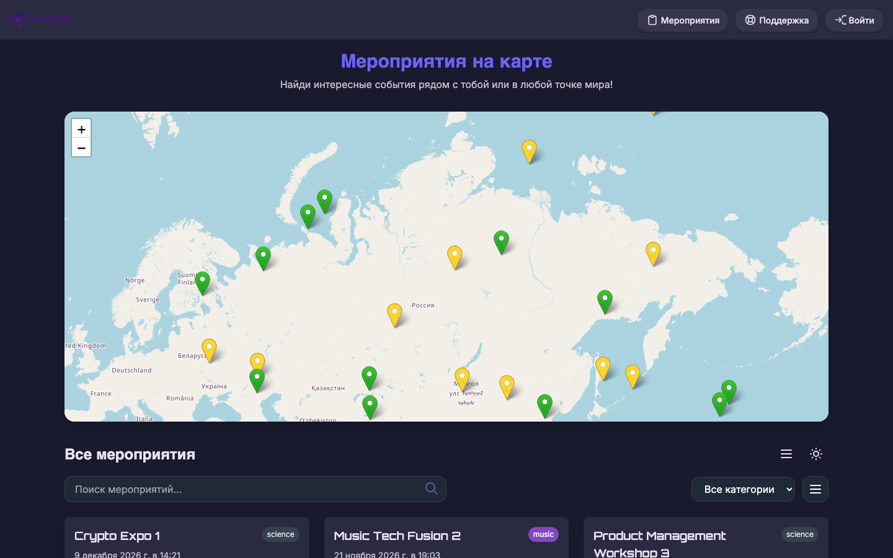
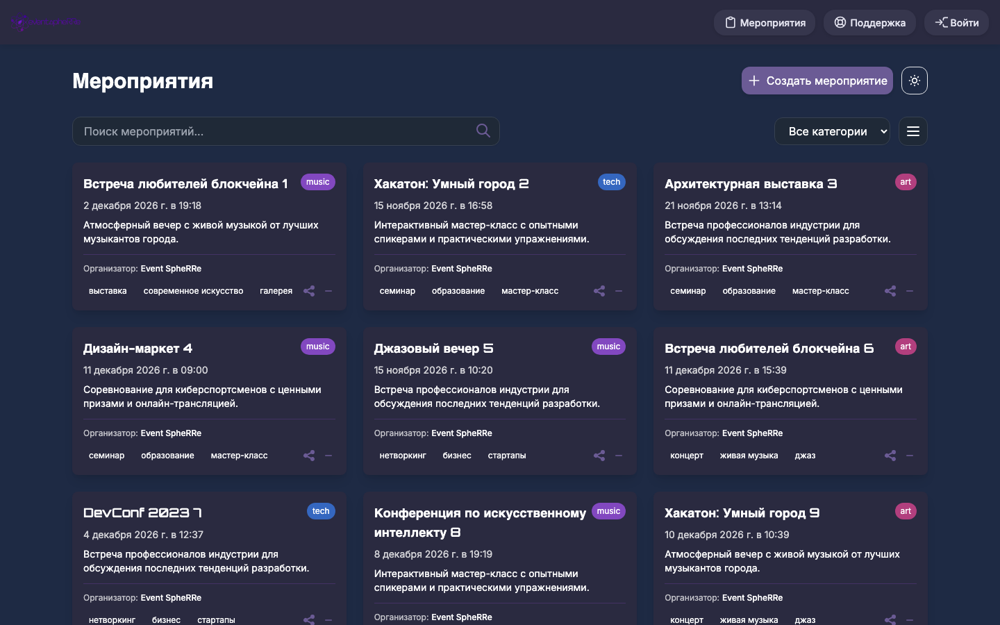

# Event Sphere · расширенная версия

Платформа команды VIPERRS для участников и организаторов мероприятий. События можно искать на карте и в каталоге. По сравнению с первой версией появились отдельная страница мероприятий и статистика, а учётные записи перенесены в PostgreSQL. Карточки на главной используют демонстрационные данные.



*Главная страница с картой мероприятий*



*Каталог с карточками событий*

## Запуск

Для локального запуска установите Docker с Compose. Интерфейс использует порт 3000, API — 8080.

```bash
docker compose up --build
```

Откройте [localhost:3000](http://localhost:3000). PostgreSQL использует локальный порт 5432.

## Что проверено

Собраны клиент Nuxt и Go-сервер. Проверено отображение карты и каталога в браузере. Полный запуск стека в Docker при проверке прервался из-за нехватки места в диске Docker Desktop.

## Авторство

Команда VIPERRS — И. В. Адигамов, Р. Г. Уразаев, В. Г. Кузнецов. [Исходный репозиторий](https://github.com/Danon1336/event-spheRRe)
